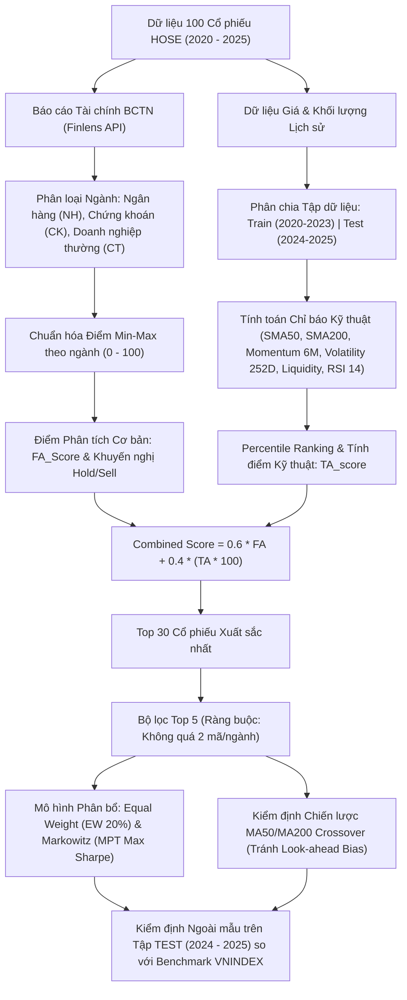

# 📈 HỆ THỐNG KIỂM ĐỊNH CHIẾN LƯỢC ĐẦU TƯ KẾT HỢP FA & TA (HOSE 2020 - 2025)

[](https://streamlit.io)
[](https://www.python.org/downloads/)
[](https://opensource.org/licenses/MIT)

Ứng dụng web định lượng chuyên sâu (Quantitative Investment Dashboard) được xây dựng trên nền tảng **Streamlit**, dùng để kiểm định và trực quan hóa chiến lược đầu tư kết hợp giữa **Phân tích Cơ bản (Fundamental Analysis - FA)** và **Phân tích Kỹ thuật (Technical Analysis - TA)**, áp dụng mô hình phân bổ danh mục **Markowitz (Modern Portfolio Theory - MPT)** và chiến lược giao dịch **MA Crossover** trên rổ 100 cổ phiếu niêm yết tại Sở Giao dịch Chứng khoán TP.HCM (**HOSE**).

---

## 🌟 ĐIỂM NỔI BẬT & KẾT QUẢ KIỂM ĐỊNH CỐT LÕI

Quá trình kiểm định ngoài mẫu (**Out-of-Sample Testing**) trên tập dữ liệu **TEST (2024 - 2025)** mang lại các kết quả thực nghiệm vượt trội:

| Danh mục / Chiến lược | Lợi nhuận lũy kế | Biến động năm | Tỷ số Sharpe | Max Drawdown | Đánh giá so với VNINDEX |
| :--- | :---: | :---: | :---: | :---: | :--- |
| **Top 5 Equal Weight (HDB, LPB, KDH, SSI, TCH)** | **+96.10%** | 24.60% | **1.6503** | **-20.68%** | **Vượt trội tuyệt đối (+68.25% Alpha, Sharpe gấp 2.56 lần)** |
| **Top 30 Minimum Variance (MVP)** | **+45.18%** | **21.61%** | **0.9606** | **-22.64%** | **Giảm rủi ro biến động 5.29% so với Equal Weight (22.82%)** |
| **Top 30 Equal Weight** | +38.39% | 22.82% | 0.7830 | -23.29% | Vượt trội thị trường chung |
| **Chiến lược MA50/MA200 Crossover** | +27.04% | 21.24% | 1.0482 | **-17.98%** | **Mức sụt giảm thấp nhất, bảo toàn vốn tối ưu** |
| **Benchmark VNINDEX** | +27.85% | 20.59% | 0.6429 | -25.78% | Chuẩn so sánh thị trường |

### 4 Giả thuyết Nghiên cứu Cốt lõi:
1. **Giả thuyết H1 (Giảm thiểu rủi ro biến động)**: Danh mục Minimum Variance (MVP) giảm được **5.29%** độ biến động so với Equal Weight trên tập kiểm thử ngoài mẫu.
2. **Giả thuyết H2 (Lợi nhuận vượt trội)**: Danh mục kết hợp Top 5 (+96.10%) và Top 30 MVP (+45.18%) chiến thắng áp đảo chỉ số thị trường VNINDEX (+27.85%).
3. **Giả thuyết H3 (Tỷ số Sharpe)**: Tỷ số Sharpe danh mục Top 5 đạt **1.6503** (vượt xa VNINDEX 0.6429), chứng minh hiệu quả sinh lời trên một đơn vị rủi ro cao vượt bậc.
4. **Giả thuyết H4 (Khả năng phòng thủ Max Drawdown)**: Danh mục có mức sụt giảm tối đa an toàn hơn thị trường (-20.68% so với -25.78%). Đặc biệt chiến lược MA Crossover giảm mức sụt giảm về chỉ còn **-17.98%**.

---

## 🏗️ KHUNG PHƯƠNG PHÁP LUẬN (METHODOLOGY)



1. **Phân tích Cơ bản (FA)**:
   - Tính toán 5 nhóm chỉ tiêu: Khả năng thanh toán (Solvency), Đòn bẩy tài chính (Leverage), Khả năng sinh lời (Profitability), Hiệu quả quản lý tài sản (Asset Efficiency), và Tốc độ tăng trưởng (Growth).
   - Nhóm Ngân hàng (NH) được bổ sung các chỉ tiêu chuyên biệt: **NIM**, **NPL** (Tỷ lệ nợ xấu), **CAR** (Hệ số an toàn vốn), và **P/B**.
   - Chuẩn hóa Min-Max theo từng nhóm ngành và xác định ngưỡng khuyến nghị Hold/Sell dựa trên trung vị (Median) ngành.

2. **Phân tích Kỹ thuật (TA)**:
   - Xếp hạng bách phân vị trên tập Train (2020 - 2023): Trend ($SMA50/SMA200 - 1$), Momentum 6M (126 phiên), Biến động năm 252 phiên, Thanh khoản bình quân 20 phiên, và RSI(14) ưu tiên vùng tối ưu 50 - 70 (quanh mốc 60).

3. **Danh mục Phối hợp & Đa dạng hóa**:
   - Tính điểm tổng hợp: $Combined\_Score = 0.6 \times FA + 0.4 \times (TA \times 100)$.
   - Lọc Top 30 và chọn Top 5 cổ phiếu giải ngân thực tế (**HDB, LPB, KDH, SSI, TCH**) với quy tắc không quá 2 mã cùng một ngành để triệt tiêu rủi ro tập trung.

4. **Tối ưu hóa Danh mục & Kiểm định Ngoài mẫu**:
   - So sánh phân bổ Equal Weight (20% mỗi mã) và Tối ưu hóa Markowitz (Max Sharpe Ratio với ràng buộc tỷ trọng mỗi mã từ 5% đến 30%).
   - Kiểm định chiến lược giao cắt MA50/MA200 (Golden Cross / Death Cross) với tín hiệu trễ 1 ngày (`shift(1)`) loại trừ hoàn toàn thiên lệch nhìn trước tương lai (look-ahead bias).

---

## 📁 CẤU TRÚC THƯ MỤC DỰ ÁN

```text
Thuyet_trinh_ket_hop_FA_TA/
├── app.py                         # Ứng dụng Web Streamlit chính
├── requirements.txt               # Danh sách thư viện phụ thuộc (tương thích Streamlit Cloud)
├── README.md                      # Tài liệu hướng dẫn sử dụng và báo cáo nghiên cứu
├── Ket_Qua_Phan_Tich_Dau_Tu.xlsx   # Dữ liệu kết quả phân tích 4 sheet từ Notebook
├── HOSE_2020_2025_updated.csv     # Dữ liệu giá & khối lượng lịch sử 100 mã HOSE (2020 - 2025)
└── Kết_hợp_FA_TA.ipynb            # Jupyter Notebook mã nguồn phân tích gốc
```

---

## 🚀 HƯỚNG DẪN CÀI ĐẶT & CHẠY DỰ ÁN

### 1. Chạy trên máy tính cá nhân (Local Environment)

#### Bước 1: Clone hoặc tải thư mục mã nguồn
```bash
git clone https://github.com/<your-username>/<your-repo-name>.git
cd <your-repo-name>
```

#### Bước 2: Tạo môi trường ảo Python (Khuyến nghị Python 3.10 - 3.12)
```bash
python -m venv venv

# Kích hoạt trên Windows:
venv\Scripts\activate

# Hoặc trên macOS / Linux:
source venv/bin/activate
```

#### Bước 3: Cài đặt các thư viện cần thiết
```bash
pip install -r requirements.txt
```

#### Bước 4: Khởi chạy Web App Streamlit
```bash
streamlit run app.py
```
Trình duyệt sẽ tự động mở tại địa chỉ: `http://localhost:8501`.

---

## ☁️ HƯỚNG DẪN DEPLOY LÊN STREAMLIT COMMUNITY CLOUD (3 BƯỚC)

Ứng dụng được tối ưu hóa đặc biệt với các thư viện tiêu chuẩn thuần Python, không phụ thuộc vào các thư viện C-compiler phức tạp, giúp quá trình deploy trên **Streamlit Community Cloud** diễn ra nhanh chóng:

### Bước 1: Đẩy mã nguồn lên GitHub
1. Tạo một repository mới trên [GitHub](https://github.com/) (ví dụ: `hose-fa-ta-portfolio`).
2. Khởi tạo Git và đẩy các file lên repository:
```bash
git init
git add app.py requirements.txt README.md Ket_Qua_Phan_Tich_Dau_Tu.xlsx HOSE_2020_2025_updated.csv
git commit -m "Deploy quantitative FA-TA investment app"
git branch -M main
git remote add origin https://github.com/<your-username>/hose-fa-ta-portfolio.git
git push -u origin main
```

### Bước 2: Đăng nhập vào Streamlit Community Cloud
1. Truy cập [share.streamlit.io](https://share.streamlit.io/) và đăng nhập bằng tài khoản GitHub của bạn.

### Bước 3: Tạo và Triển khai App
1. Nhấn nút **"New app"**.
2. Chọn Repository của bạn: `<your-username>/hose-fa-ta-portfolio`.
3. Nhánh (Branch): `main`.
4. File đường dẫn chính (Main file path): `app.py`.
5. Nhấn **"Deploy!"**.
Chờ khoảng 1-2 phút, ứng dụng sẽ hoạt động trên Internet với đường dẫn công khai miễn phí!

---

## 🖥️ CÁC TÍNH NĂNG TRÊN GIAO DIỆN WEB APP

- **Sidebar (Bảng điều khiển & Tùy biến Tham số)**:
  - Cho phép tùy chỉnh tổng vốn đầu tư ban đầu (mặc định 500,000,000 VNĐ).
  - Tùy chỉnh slider trọng số kết hợp FA / TA ($w_{FA}$ và $w_{TA}$). Hệ thống sẽ tự động tính toán lại điểm số và xếp hạng Top cổ phiếu theo thời gian thực!
  - Lựa chọn linh hoạt giữa việc sử dụng dữ liệu mặc định của đề tài hoặc upload tệp Excel/CSV mới của bạn.
- **Tab 1: 🏆 Kiểm định & Benchmark**:
  - Tóm tắt kết quả kiểm định 4 giả thuyết khoa học với badge trạng thái.
  - Bảng so sánh chỉ số định lượng đầy đủ (Cumulative Return, Volatility, Sharpe, MDD).
  - Biểu đồ tăng trưởng tài sản tích lũy (Cumulative Equity Growth) và biểu đồ sụt giảm tài sản (Underwater Drawdown) tương tác mượt mà.
- **Tab 2: 🏢 Phân tích Cơ bản (FA)**:
  - Biểu đồ phân bổ cơ cấu ngành (NH, CK, CT).
  - Xếp hạng Top 10 doanh nghiệp có sức khỏe tài chính tốt nhất.
  - Biểu đồ Radar đa giác thể hiện 5 nhóm năng lực tài chính cho từng mã cổ phiếu được chọn.
- **Tab 3: 📈 Phân tích Kỹ thuật (TA)**:
  - Bảng xếp hạng bách phân vị kỹ thuật của 100 mã cổ phiếu HOSE.
  - Phân tích tương quan giữa Trend Score, Momentum 6M, Volatility và Liquidity.
- **Tab 4: 🎯 Danh mục & Tối ưu Markowitz**:
  - Danh sách Top 30 và Top 5 cổ phiếu đại diện.
  - Bảng chi tiết phân bổ tỷ trọng và vốn đầu tư bằng VNĐ giữa Tỷ trọng Đều (EW 20%) và Tối ưu hóa Markowitz (MPT Max Sharpe).
  - Biểu đồ so sánh phân bổ tỷ trọng.
- **Tab 5: ⚡ Chiến lược MA Crossover**:
  - Kiểm định chiến lược Trend Following (MA50 cắt lên MA200) trên tập Test 2024 - 2025.
  - Trực quan hóa đường giá, SMA50, SMA200 và các điểm mua Golden Cross cho từng cổ phiếu.
- **Tab 6: 🔬 Tra cứu Cổ phiếu**:
  - Bộ công cụ tra cứu chi tiết từng mã cổ phiếu: Điểm FA, Điểm TA, Khuyến nghị, biểu đồ nến Candlestick + SMA + RSI(14).
- **Tab 7: 📚 Phương pháp luận & Lý thuyết**:
  - Diễn giải chi tiết công thức toán học, nguyên lý chuẩn hóa và cơ sở học thuật của đề tài.

---

## 👥 THÔNG TIN ĐỀ TÀI & TÁC GIẢ

- **Học phần**: Quản trị Danh mục Đầu tư
- **Chương trình**: Cao học Tài chính - Ngân hàng
- **Đề tài**: Nghiên cứu & Kiểm định Chiến lược Đầu tư Kết hợp Phân tích Cơ bản (FA) và Phân tích Kỹ thuật (TA) trên Thị trường Chứng khoán Việt Nam (HOSE 2020 - 2025)

---
*Phát triển với ❤️ phục vụ mục đích học tập, nghiên cứu khoa học và ứng dụng đầu tư định lượng thực tiễn.*
